# Modelo de dados do resolv!

No Mural, um morador pede ajuda. Na Vitrine, ele encontra quem atende a região. O modelo liga esses dois caminhos ao chat e preserva a diferença entre o orçamento público do pedido e o valor discutido em particular. O protótipo Flutter salva os dados no aparelho. Os scripts desta pasta de projeto implementam o modelo relacional e as automações da atividade no Oracle.

## MER · Entidades e regras de negócio

| Relação | Cardinalidade e significado |
| --- | --- |
| Pessoa, bairro e vizinhança | Cada pessoa tem um bairro de residência. Cada bairro pode ter vários moradores e vários vizinhos. Uma ligação entre dois bairros vale nos dois sentidos. |
| Pessoa, especialidade e cobertura | O mesmo perfil pode pedir e prestar serviços. Para ativar o modo profissional, o morador escolhe pelo menos uma especialidade e um bairro de atendimento. Desativar o modo mantém essas escolhas. |
| Pedido, autor e tag | Cada pedido tem um autor, um bairro de publicação e uma tag. O bairro fica registrado mesmo que o autor se mude. Quem não sabe qual profissional procurar usa **Preciso de orientação**. |
| Pedido e comentário | Um pedido pode receber vários comentários. Cada comentário tem um autor e pode indicar um prestador. |
| Conversa e pedido | Uma conversa reúne exatamente duas pessoas. Pode nascer de um pedido, com participação do autor, ou de um contato direto na Vitrine. O mesmo par pode conversar diretamente e também manter um chat distinto por pedido. |
| Mensagem e proposta | Cada mensagem pertence a uma conversa e tem um remetente. Uma proposta é uma mensagem que também guarda o serviço, a descrição e a estimativa daquele momento. |
| Pedido e avaliação | O autor pode avaliar uma pessoa que o atendeu depois de marcar o pedido como resolvido. Cada pedido admite uma avaliação, com nota inteira de 1 a 5. |

## DER · Tabelas e relacionamentos

Os dois recortes abaixo compartilham as mesmas tabelas de pessoa e pedido. A ponta com três ramos indica o lado que pode ter vários registros. O círculo indica participação opcional. **PK** identifica a chave primária e **FK** identifica uma chave estrangeira. Os diagramas mostram as chaves e os principais atributos. O [DDL](../database/01_estrutura.sql) contém todas as colunas e restrições.

### Perfis, bairros e publicação



<details>
<summary>Ver a fonte Mermaid deste diagrama</summary>

```text
erDiagram
    RV_BAIRRO ||--o{ RV_PESSOA : abriga
    RV_BAIRRO ||--o{ RV_VIZINHANCA : "primeiro bairro"
    RV_BAIRRO ||--o{ RV_VIZINHANCA : "segundo bairro"
    RV_PESSOA ||--o{ RV_COBERTURA : atende
    RV_BAIRRO ||--o{ RV_COBERTURA : integra
    RV_PESSOA ||--o{ RV_ESPECIALIDADE : oferece
    RV_TAG ||--o{ RV_ESPECIALIDADE : identifica
    RV_PESSOA ||--o{ RV_PEDIDO : publica
    RV_BAIRRO ||--o{ RV_PEDIDO : localiza
    RV_TAG ||--o{ RV_PEDIDO : classifica
    RV_BAIRRO {
        number id PK
        varchar nome
    }
    RV_VIZINHANCA {
        number bairro_a PK,FK
        number bairro_b PK,FK
    }
    RV_PESSOA {
        varchar id PK
        number bairro_id FK
        varchar nome
        char profissional
    }
    RV_COBERTURA {
        varchar pessoa_id PK,FK
        number bairro_id PK,FK
    }
    RV_ESPECIALIDADE {
        varchar pessoa_id PK,FK
        varchar tag PK,FK
    }
    RV_TAG {
        varchar codigo PK
        varchar nome
    }
    RV_PEDIDO {
        varchar id PK
        varchar autor_id FK
        number bairro_id FK
        varchar tag FK
        varchar titulo
        number centavos
        varchar unidade
    }
```

</details>

A tag de orientação é válida para pedidos. Uma restrição em `RV_ESPECIALIDADE` reserva essa tag para o Mural. Na demonstração, as 16 especialidades, a tag de orientação, os oito bairros e os dez pares de vizinhos vêm do [catálogo](../database/02_catalogo.sql). A Vitrine considera a cobertura do profissional e a distância entre os bairros. A aba Serviços usa a tag, o bairro do pedido e o modo profissional ativo.

### Comentários, conversa e avaliação



<details>
<summary>Ver a fonte Mermaid deste diagrama</summary>

```text
erDiagram
    RV_PEDIDO ||--o{ RV_COMENTARIO : recebe
    RV_PESSOA ||--o{ RV_COMENTARIO : escreve
    RV_PESSOA o|--o{ RV_COMENTARIO : "pode ser indicada"
    RV_PEDIDO o|--o{ RV_CONVERSA : origina
    RV_PESSOA ||--o{ RV_CONVERSA : "participante A"
    RV_PESSOA ||--o{ RV_CONVERSA : "participante B"
    RV_CONVERSA ||--o{ RV_MENSAGEM : guarda
    RV_PESSOA ||--o{ RV_MENSAGEM : envia
    RV_PEDIDO ||--o| RV_AVALIACAO : admite
    RV_PESSOA ||--o{ RV_AVALIACAO : recebe
    RV_PESSOA {
        varchar id PK
    }
    RV_PEDIDO {
        varchar id PK
        timestamp resolvido_em
    }
    RV_COMENTARIO {
        number id PK
        varchar pedido_id FK
        varchar autor_id FK
        varchar indicado_id FK
        varchar texto
    }
    RV_CONVERSA {
        number id PK
        varchar pedido_id FK
        varchar pessoa_a FK
        varchar pessoa_b FK
    }
    RV_MENSAGEM {
        number id PK
        number conversa_id FK
        varchar autor_id FK
        varchar tipo
        clob texto
        varchar titulo
        clob descricao
        number centavos
        varchar unidade
    }
    RV_AVALIACAO {
        varchar pedido_id PK,FK
        varchar prestador_id FK
        number estrelas
    }
```

</details>

A ordem dos participantes no banco é fixa. Se Lia reabrir o chat iniciado pelo vizinho, recupera a mesma conversa. A chave primária da avaliação é o próprio pedido. O autor da avaliação é identificado pelo pedido, e o prestador avaliado é identificado por `prestador_id`.

## Como o preço chega ao chat

Um morador publica “Barra de duas calças” e informa R$ 35 por peça. O pedido guarda `3500` centavos e a unidade `piece`. Ao abrir o chat pelo pedido, o resumo apresenta esse orçamento. Se Lia propuser R$ 30 por peça, o banco grava uma mensagem com a nova proposta. A estimativa do Mural e a conversa com outro prestador continuam em R$ 35 por peça.

Se os dois decidirem discutir o preço depois, uma nova proposta pode deixar valor e unidade vazios. O resumo passa a mostrar **A combinar**. Uma mensagem comum, como “posso levar às 15h?”, jamais altera o preço. O resumo mostra a proposta mais recente, que ainda pode ser negociada.

Os exemplos de costura e reforço escolar usam os preços iniciais anunciados pelos prestadores em 17/11/2026. [SOS Ateliê](https://sosatelie.com.br/) e [Educamente](https://educamente.app.br/).

| Unidade gravada | Exibição no app |
| --- | --- |
| `service` | Pelo serviço |
| `hour` | Por hora |
| `visit` | Por visita |
| `day` | Por diária |
| `piece` | Por peça |

## Automações em PL/SQL

O pacote [RV_ATENDIMENTO](../database/03_rotinas.sql) reúne as operações abaixo. Cada rotina participa da transação de quem a chama. Os identificadores de pessoa correspondem aos participantes informados na demonstração.

| Procedimento | O que faz |
| --- | --- |
| `definir_modo` | Ativa o perfil profissional se houver especialidade e bairro de atendimento. Também permite desativá-lo. |
| `publicar_pedido` | Registra autor, tag, título, descrição e bairro no momento da publicação. Aceita foto e estimativa opcionais e devolve o identificador do pedido. |
| `comentar_pedido` | Registra um comentário e, quando há indicação, verifica se a pessoa indicada oferece serviços. |
| `abrir_conversa` | Obtém ou cria o chat entre duas pessoas. Em chats do Mural, verifica se o autor do pedido participa. |
| `enviar_mensagem` | Registra texto de um participante e mantém o preço vigente. |
| `propor_servico` | Registra a nova descrição ou o novo preço como mensagem. Alterações na mesma conversa são processadas em sequência. Reenviar a proposta vigente não duplica o histórico. |
| `resolver_pedido` | Registra a resolução pelo autor. O pedido sai da seleção de serviços em aberto. |
| `avaliar_atendimento` | Verifica autoria, resolução, prestador e nota, e grava uma avaliação por pedido. |

A consulta `RV_SERVICOS_COMPATIVEIS` cruza pedidos abertos com especialidade e cobertura e exclui os pedidos do próprio prestador. Já `RV_RESUMO_CONVERSA` seleciona a proposta mais recente de cada chat. Quando ainda não há proposta, recupera o orçamento do Mural, se houver.

## Executar e conferir

Use SQL*Plus ou SQLcl conectado a um esquema de projeto no Oracle Database Free 23ai ou versão compatível. O usuário precisa de quota no tablespace e dos privilégios `CREATE SESSION`, `CREATE TABLE`, `CREATE VIEW` e `CREATE PROCEDURE`. Os arquivos estão em UTF-8. No SQL*Plus do Windows, use um cliente configurado para UTF-8, por exemplo com `NLS_LANG=.AL32UTF8` antes de iniciar a sessão.

Na raiz do projeto Flutter, execute estes comandos no cliente Oracle.

```sql
@database/instalar.sql
@database/testar.sql
```

O [instalador](../database/instalar.sql) cria as tabelas com prefixo `RV_`, inclui os itens de catálogo que estiverem ausentes e compila as consultas e o pacote. Pode ser executado novamente sobre a mesma versão. O [teste](../database/testar.sql) cria pessoas e pedidos temporários, verifica os resultados e desfaz os dados que criou. Use uma sessão exclusiva para a instalação e o teste, pois operações de definição de tabelas confirmam a transação no Oracle.

Em 17/11/2026, as duas execuções consecutivas no Oracle Database Free 23.26.3 confirmaram a instalação e os seis grupos de testes. Um ensaio adicional com duas conexões simultâneas verificou a abertura do mesmo chat, o reenvio da proposta vigente e a tentativa de avaliar o mesmo pedido duas vezes. Em cada caso, o banco manteve um único registro.
